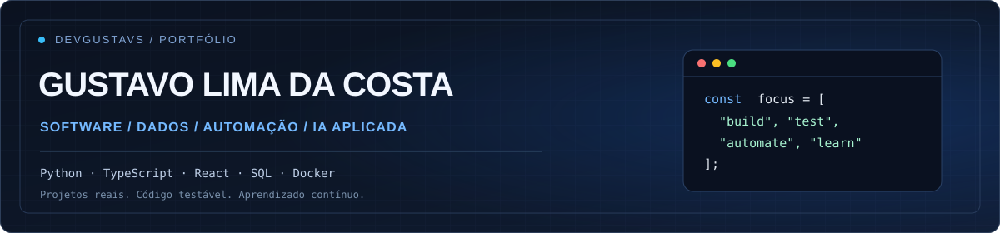

### Olá, eu sou o Gustavo! 👋

**Desenvolvimento de Software · Dados · Automação · IA Aplicada**

Desenvolvedor em início de carreira, criando soluções práticas com código, bancos de dados e integrações.  
Busco oportunidades em tecnologia para contribuir, aprender e evoluir com uma equipe.

---

### Como eu trabalho

Prefiro entender o problema antes de escolher as ferramentas. Costumo dividir o desenvolvimento em etapas pequenas, testar o que fiz e ajustar com base no resultado.

Gosto de manter o código e a organização dos projetos simples de acompanhar. Uso Git, testes e documentação quando fazem diferença para identificar erros, registrar decisões e continuar o trabalho sem perder o contexto.

Com automações e IA, sigo a mesma lógica: experimentar, conferir o comportamento e manter o controle sobre o resultado. Não vejo vantagem em complicar uma solução que já funciona bem.

---

### My daily driver

Windows · VS Code · GitHub · PowerShell · Docker · Cursor

---

### Core Stack

Python · TypeScript · Node.js · React · Astro · Tailwind CSS · Docker · Git

---

### Tools & Technologies

**Development**

JavaScript · HTML · CSS · npm · Vite · Figma · Linux

**Data & Backend**

PostgreSQL · SQL · Oracle · Supabase · Firebase · DuckDB · Pandas · Parquet · SQLite

**AI & Agents**

ChatGPT · Codex · Claude Code · Gemini · Gemini CLI · Grok · agentes de IA

**Automation & Knowledge**

n8n · APIs REST · Webhooks · Workflows · Canva · Obsidian · Notion

---

### Analytics

 

 

As estatísticas são geradas por serviços externos e podem variar conforme a disponibilidade e visibilidade dos repositórios.

